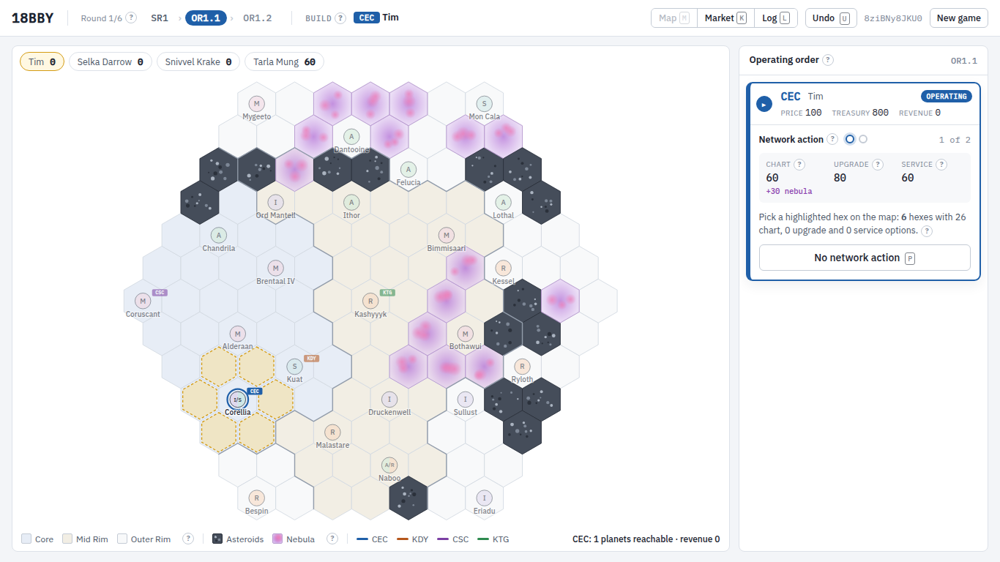

# 18BBY

An 18xx-style game of hyperspace commerce set in the Star Wars galaxy, 18 years before the
Battle of Yavin. Corporations chart a shared hyperspace network, establish service on it, and
earn revenue by pairing the planets they can reach.

This repository holds the rules engine, a bot playtest harness, a JSON API, and a browser UI.

## Layout

- `docs/design/` — the source design documents (economic rules, charting and service, map).
- `docs/DECISIONS.md` — the day-one rule decisions that fill the gaps the design docs leave open.
- `src/bby18/` — the engine.
  - `hexgrid.py` axial hex coordinates; `board.py` the fixed map; `network.py` shared tiles and
    per-corporation service; `revenue.py` planet-pair matching; `market.py` the two-dimensional stock market;
    `game.py` rule enforcement; `runner.py` round sequencing; `bots/` automated players;
    `playtest.py`, `metrics.py`, `sweep.py` and `cli.py` the harness.
  - `config.py` holds every tunable number.
- `tests/` — pytest suite.
- `web/` — the browser frontend (see Frontend below).

## Setup

```sh
uv sync
uv run pytest
uv run mypy src
uv run black src tests
```

## Playtesting

```sh
uv run bby18 playtest --games 50 --players 3          # aggregate stats over many bot games
uv run bby18 playtest --bots random --games 20        # random-play baseline / fuzzing
uv run bby18 replay --seed 7                          # full log of one game
```

Change values in `src/bby18/config.py` (or construct a `GameConfig`) to test rule variants.

`--bots` (and a sweep spec's `"bots"`) takes a named kind from `BOT_KINDS` in
`src/bby18/playtest.py`: `greedy`, `random`, or a greedy variant (`greedy-rs`, `greedy-best`,
`greedy-hold`, `greedy-sell`, `greedy-max`) built from a `GreedyPolicy` in
`src/bby18/bots/greedy.py`. The plain greedy bot always starts one corporation, in config
order, at the lowest par, so seat and homeworld are confounded; the variants vary that. A
string like `mix:greedy,greedy-rs` assigns kinds to seats round-robin, starting with seat 1.

For balance sweeps across many variants, seeds and player counts, run games in parallel with
`bby18 sweep`. It appends one JSON row of metrics per game to `--out` as games finish
(`--resume` continues an interrupted run) and writes per-group means, win rates by seat and
float rates by corporation to `--summary`. See `uv run bby18 sweep --help` for the spec format.

```sh
echo '{"variants": {"baseline": {}}, "grid": {"chart_cost": [10, 20, 30]},
       "seeds": [1, 32], "players": [2, 3, 4], "bots": ["greedy"]}' > spec.json
uv run bby18 sweep --spec spec.json --out results.jsonl --summary summary.json --workers 16
```

## Frontend

A browser UI for hotseat play lives in `web/` (Vite, React, TypeScript). Run the API with
`uv run bby18 serve --port 8000`, then `cd web && npm install && npm run dev`, and open
http://localhost:5173. See [`web/README.md`](web/README.md) for details.


