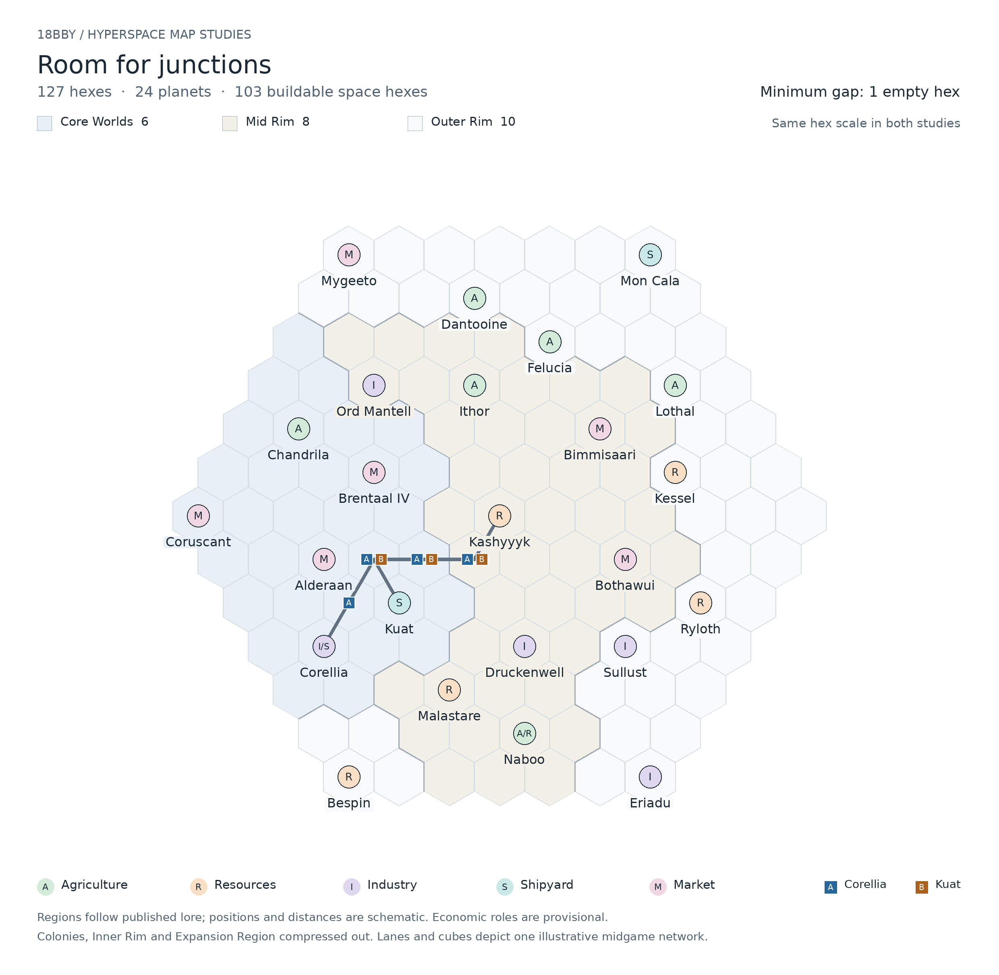

# 18BBY — 127-Hex Map Design

**Working map:** Room for junctions  
**Status:** Selected layout for further development; economic roles and starting positions remain provisional.  
**Recorded:** September 27, 2026

## Purpose

This document records the preferred 127-hex map from the hyperspace map studies. It preserves the illustrated planet placements and provides enough information to reconstruct the board exactly.

The map supports the shared hyperspace network described in *18 BBY — Hyperspace Charting and Service*: corporations chart lane shapes, upgrade junctions, and place service cubes on the tiles they operate. Planet-pair revenue remains the economic model.

The Core sits on the left. The Mid Rim forms an intermediate band, and the Outer Rim extends around the upper, right, and lower edges. Every planet is separated from every other planet by at least two hex steps, leaving room for at least one intervening space hex. There are no adjacent planets in this version.

## Map image



The gray lanes and A/B cubes depict an illustrative midgame network. They are not preprinted starting connections. A and B are example corporations based at Corellia and Kuat; these homeworld assignments are not settled setup rules.

## Board specification

| Property | Value |
|---|---|
| Shape | Regular hexagonal board of pointy-top hexes |
| Radius | 6 hex steps from the center |
| Hexes along each outer side | 7 |
| Hexes across the central row | 13 |
| Total hexes | 127 |
| Planet hexes | 24 |
| Initially uncharted space hexes | 103 |
| Core Worlds | 6 |
| Mid Rim worlds | 8 |
| Outer Rim worlds | 10 |
| Minimum planet-to-planet distance | 2 hex steps |

All nonplanet hexes are potentially chartable. This version has no impassable terrain, fixed hyperspace corridors, or special construction-cost zones. Charting costs and action allowances remain open design questions.

## Coordinates and reconstruction

Use **axial coordinates `(q, r)`** on a pointy-top hex grid. The board's geometric center is `(0, 0)`, occupied by Kashyyyk. This origin is a drawing convention; it does not identify the center of the Star Wars galaxy.

With screen coordinates increasing downward, positive `q` points right and positive `r` points down-right. The six neighboring hexes are:

| Direction on the drawing | Coordinate change |
|---|---|
| Right | `(1, 0)` |
| Down-right | `(0, 1)` |
| Down-left | `(-1, 1)` |
| Left | `(-1, 0)` |
| Up-left | `(0, -1)` |
| Up-right | `(1, -1)` |

Include every integer coordinate satisfying:

```text
max(abs(q), abs(r), abs(q + r)) <= 6
```

This defines all 127 board hexes. Place the 24 planets at the coordinates below; every other included coordinate is an empty space hex.

For rendering, let `s` be the hex side length and `(x0, y0)` the center of the drawing:

```text
x = x0 + sqrt(3) * s * (q + r / 2)
y = y0 + 1.5 * s * r
```

For two hexes, calculate `dq = q2 - q1` and `dr = r2 - r1`. Their geometric distance is:

```text
distance = max(abs(dq), abs(dr), abs(dq + dr))
```

Actual service connections must follow charted tile exits and may take longer than this geometric distance.

## Planet roster

The following are **game-board coordinates**, not galactic atlas coordinates. The economic roles are the proposals shown on the map, retained for discussion and playtesting.

| Code | Proposed economic role |
|---|---|
| A | Agriculture |
| R | Resources |
| I | Industry |
| S | Shipyard |
| M | Market |

A slash indicates two available economic tags. A dual-tag planet still participates in at most one scored pair per corporation per operating round.

### Core Worlds — 6 planets

| Planet | q | r | Tags | Proposed role |
|---|---:|---:|---|---|
| Coruscant | -6 | 0 | M | Market |
| Chandrila | -3 | -2 | A | Agriculture |
| Brentaal IV | -2 | -1 | M | Market |
| Alderaan | -4 | 1 | M | Market |
| Kuat | -3 | 2 | S | Shipyard |
| Corellia | -5 | 3 | I/S | Industry + Shipyard |

### Mid Rim — 8 planets

| Planet | q | r | Tags | Proposed role |
|---|---:|---:|---|---|
| Ord Mantell | -1 | -3 | I | Industry |
| Ithor | 1 | -3 | A | Agriculture |
| Kashyyyk | 0 | 0 | R | Resources |
| Bimmisaari | 3 | -2 | M | Market |
| Bothawui | 2 | 1 | M | Market |
| Druckenwell | -1 | 3 | I | Industry |
| Malastare | -3 | 4 | R | Resources |
| Naboo | -2 | 5 | A/R | Agriculture + Resources |

### Outer Rim — 10 planets

| Planet | q | r | Tags | Proposed role |
|---|---:|---:|---|---|
| Mygeeto | 0 | -6 | M | Market |
| Dantooine | 2 | -5 | A | Agriculture |
| Felucia | 3 | -4 | A | Agriculture |
| Mon Cala | 6 | -6 | S | Shipyard |
| Lothal | 5 | -3 | A | Agriculture |
| Kessel | 4 | -1 | R | Resources |
| Ryloth | 3 | 2 | R | Resources |
| Sullust | 1 | 3 | I | Industry |
| Eriadu | 0 | 6 | I | Industry |
| Bespin | -6 | 6 | R | Resources |

## Geographic and economic intent

The Core concentrates several Markets and the shipbuilding centers of Kuat and Corellia. Chandrila adds an agricultural role within the Core. This provides local opportunities without requiring every corporation to expand immediately to the edge of the board.

The Mid Rim offers intermediate destinations and potential branching points. Its proposed mix includes Industry at Ord Mantell and Druckenwell, Resources at Kashyyyk and Malastare, Agriculture at Ithor, and Markets at Bimmisaari and Bothawui. Naboo's Agriculture/Resources combination is a provisional dual-tag proposal.

The Outer Rim contains destinations that can support regional trade as well as long connections to the Core. Mon Cala provides a distant Shipyard, Sullust and Eriadu provide Industry, and Mygeeto provides a Market. Dantooine, Felucia, and Lothal have proposed agricultural roles; Kessel, Ryloth, and Bespin have resource roles.

Planet regions follow the published references used for the map studies. The positions compress and rearrange geography for play; exact bearings, physical distances, and named canonical hyperspace routes are not reproduced. The Colonies, Inner Rim, and Expansion Region are compressed out of this board. Economic tags are game abstractions, not exhaustive descriptions of a planet's economy or guarantees about its precise state in 18 BBY.

### Region shading

To reproduce the image's background, assign each hex the region of its nearest planet by axial hex distance. Resolve ties between regions in this order: Core, Mid Rim, Outer Rim. Draw boundaries where neighboring hexes have different assigned regions.

This is a visual convention for the draft. The planet roster supplies each planet's region for any future endpoint-based regional bonus. Shading does not currently change construction costs or travel permissions.

## Illustrated lane and service example

The image shows two corporations sharing a route toward Kashyyyk:

- **Corporation A:** Corellia `(-5, 3)` → `(-4, 2)` → `(-3, 1)` → `(-2, 1)` → `(-1, 1)` → Kashyyyk `(0, 0)`.
- **Corporation B:** Kuat `(-3, 2)` → `(-3, 1)` → `(-2, 1)` → `(-1, 1)` → Kashyyyk `(0, 0)`.

The charted space tiles are:

| Tile coordinate | Exits connect to these neighboring hexes | Service cubes |
|---|---|---|
| `(-4, 2)` | `(-5, 3)`, `(-3, 1)` | A |
| `(-3, 1)` | `(-4, 2)`, `(-3, 2)`, `(-2, 1)` | A and B |
| `(-2, 1)` | `(-3, 1)`, `(-1, 1)` | A and B |
| `(-1, 1)` | `(-2, 1)`, `(0, 0)` | A and B |

The tile at `(-3, 1)` is the sole three-exit junction. The other three space tiles each have two exits. A could initially chart the connection from Corellia to Kashyyyk; a later upgrade could add the Kuat-facing exit while preserving the original connections. B would then need service on the shared tiles to reach Kashyyyk.

This example demonstrates compatible geometry and service markings. It does not specify construction timing, costs, or which actions can be combined in a turn.

## Relationship to the working rules

Initial charting places a tile with exactly two connected exits. A later charting action may add a third exit while preserving existing connections. The tile geometry is shared; cubes identify each corporation's service on it. First charting automatically establishes the charting corporation's service, and subsequent service extensions must connect to that corporation's existing network.

Revenue uses only planets reachable through a continuous path of charted tiles carrying the corporation's service. The existing non-overlapping planet-pair scoring rule remains in effect. No additional train-style route scoring or service-capacity restriction is introduced by this map.

## Items still to settle

- Final economic tags, pair values, and any named-route exceptions.
- Number of corporations, homeworld choices, and initial service.
- Planet-hex connection rules, including travel through a planet and branching at a planet.
- Charting, upgrading, and service-extension costs and action allowances.
- Whether spacing and expansion costs create the intended pace in playtests.
- Whether later Imperial infrastructure or hazards require map changes.

## References and companion material

- Project rules: *18 BBY — Basic Economic Rules (Working Draft)*, supplied as `pasted.txt`.
- Project rules: *18 BBY — Hyperspace Charting and Service*.
- Selected map image: `18bby-hyperspace-127-hexes.png`.
- The portable bundle includes `18bby-127-hex-map.json`, containing only this map's coordinates, proposed roles, board cells, and illustrative network.
- [Star Wars: The Essential Atlas — online appendix](https://lumiere-a.akamaihd.net/v1/documents/starwars_7c65cf9e.pdf): regional and coarse positional references for most of the roster. This older appendix incorporates Legends material.
- [Imperial Combat Drivers — StarWars.com Databank](https://www.starwars.com/databank/imperial-combat-drivers): Lothal's Outer Rim location and agricultural context.
- [Lothal — Wookieepedia](https://starwars.fandom.com/wiki/Lothal): supplemental coarse placement reference.
- [Bimmisaari — Wookieepedia](https://starwars.fandom.com/wiki/Bimmisaari): supplemental Mid Rim reference.
